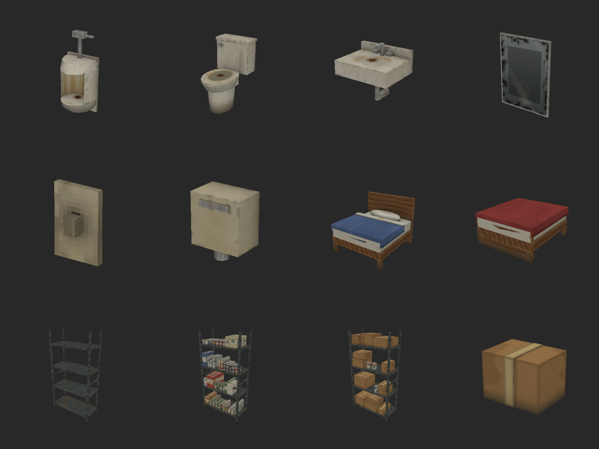

# Viewpoint Model Fix

An add-on for [Viewpoint](https://steamcommunity.com/sharedfiles/filedetails/?id=3809306528), the first-person mod for Project Zomboid Build 42.
Viewpoint builds most furniture out of the flat isometric sprites, and that looks wrong on shapes like urinals, toilets, sinks, beds and wall fittings.
This mod uses Viewpoint's own **model packs** to replace those sprites with real low-poly 3D models.
Each model has its own texture, painted to look worn and grimy like the rest of the game.
It doesn't change Viewpoint itself.



## Install

1. Close the game and run `install.bat`. It downloads this mod into `C:\Users\<you>\Zomboid\mods\ViewpointModelFix`.
   Run it again to update. You can also copy `Contents/mods/ViewpointModelFix` there by hand.
2. Enable **Viewpoint Model Fix** in the mod list, after Viewpoint.
   For a save that already exists, also enable it in that save's own mod list (Load → the save → Mods).
3. In Viewpoint's settings window (DELETE), check that **World → Model packs** has this pack on.
   Also check that **Levels of detail → Model packs' models within (chunks)** isn't 0.

## How the models get used

You don't need to set anything up. As the map loads, the mod checks each object's name.
Urinals, toilets, wall sinks, beds, mirrors, light switches, hand dryers and metal shelving get their model straight away.
Beds come in colours to match the blanket: plain, blue, red or pink, and green.
The head end of a bed has a headboard, a pillow and the blanket turned down; the foot end has a footboard.
If the pillows come out at the foot of every bed, set `ViewpointModelFix.PILLOW_AT_BACK` to `false` in the Lua file.

A stocked shelf shows its goods through an overlay sprite, which the game takes away when the shelf is emptied.
Each overlay found on a shelf gets a goods model: shop stock (cans, bottles, jars, packets) or storeroom stock (taped boxes, paint tins).
Storeroom stock is used when the room or overlay name has a word from `ViewpointModelFix.STORAGE_WORDS`.
There are three arrangements of each, so a row of shelves doesn't repeat.
Sinks set into kitchen counters are left alone.
Anything it finds is remembered in `Zomboid/Lua/ViewpointModelFix_learned.txt`, so on the next start those objects get their models immediately.

**Shift+F7** reloads the models from disk without restarting the game.
Run `install.bat` with the game still open, then press Shift+F7 in game.
Changed models, textures and `bind.` lines in `pack.txt` show up straight away.
A new kind of model, or a change to the Lua file, still needs a restart.

**F7** lists the objects around you, and whether each one has a model, in `Zomboid/Lua/ViewpointModelFix_binds.txt`.
It also lists overlays (such as a shelf's goods) and which end of a bed each tile is.
To give a model to something the mod doesn't catch, copy its `bind.` line into `pack.txt`.

If a model comes out turned the wrong way, change `ViewpointModelFix.DEGREES` in `media/lua/client/ViewpointModelFix.lua`.
Objects found earlier are bound again with the new turn as they load.
The cardboard box model is only used if you bind it by hand.

If a urinal still looks flat, another model pack, such as Viewpoint Tile Fix, may be binding the same object.
Try turning that pack off in Viewpoint's settings (DELETE) under World → Model packs.

## Bind format

```
model.<key>=<file>.obj
bind.<sprite name>=<model key>,<degrees>,<x>,<y>,<z>,<scale>
```

Models are Wavefront OBJ files. Each one names a `.mtl` file whose `map_Kd` is a PNG texture.
One unit is one tile, Y is up, and the tile's centre is the origin.

## Changing or adding models

The models and their textures are generated by the scripts in `tools/` (Python with numpy, scipy and Pillow):

- `build_models.py` holds the shapes.
- `meshlib.py` builds and writes the meshes.
- `bake.py` unwraps each model and works out, for every texel, its place in 3D, how enclosed it is and how near an edge.
- `materials.py` paints the materials from that: grime in corners, dirt near the floor, drips, rust, stains and worn edges.

```
python3 tools/build_models.py [model ...]   # writes the OBJ, MTL and PNG files
python3 tools/preview_models.py             # renders them to previews/
```

Textures ship in `42/` only. The copies of the OBJ and MTL files in `common/` point back at them.

You can also make a model in Blender. Export it as OBJ with Y up and a PNG texture.
Put it next to `pack.txt`, add a `model.` line for it, and bind sprites to it.
